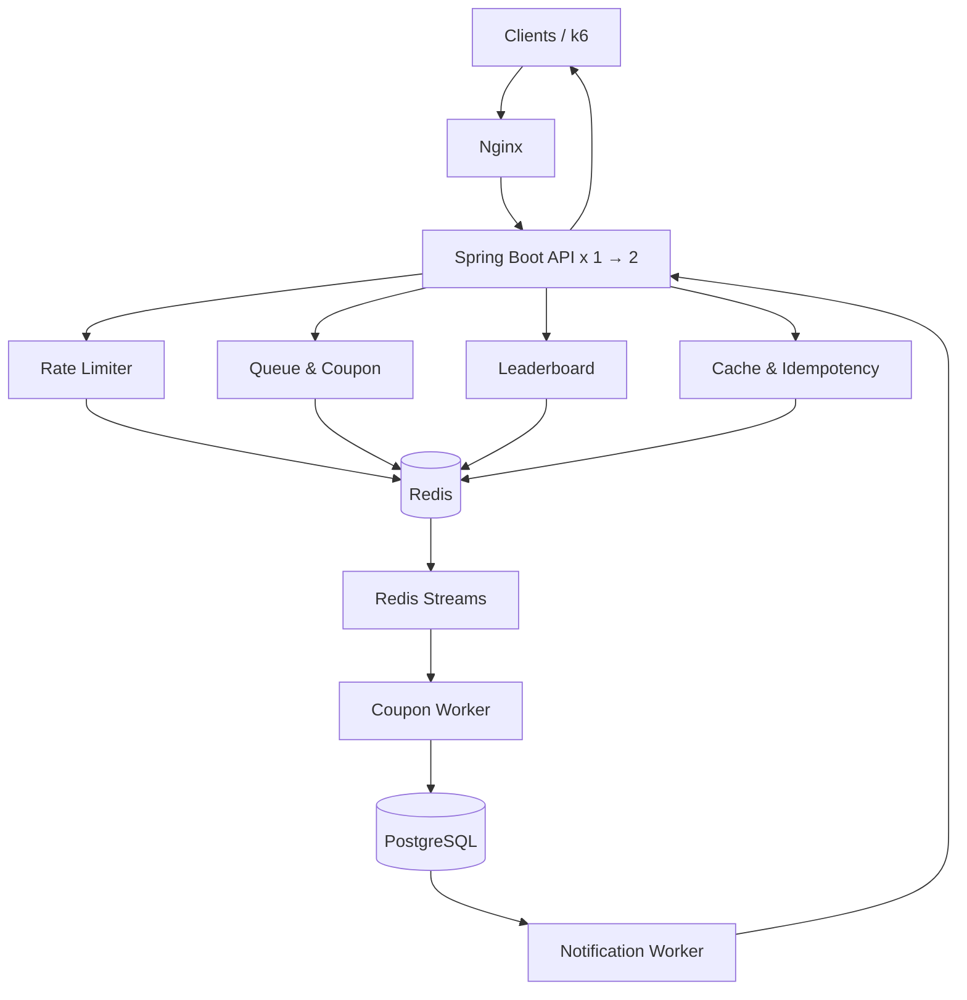

# Redis Event Platform

> 대규모 트래픽 환경에서 동시성, 정합성, 처리량과 장애 복구를 검증하는 Redis 기반 이벤트 플랫폼.

**Status:** Bootstrap · **Environment:** Rocky Linux 9/10 (on-premises lab) · **Architecture:** Modular monolith first

## 로컬 개발 시작

필수 환경: **Eclipse Temurin JDK 25**, Docker Engine/Desktop와 Compose v2.
Gradle은 Wrapper로 실행한다(9.8.2). Spring Boot는 4.0.9로 고정했다.

```bash
cp .env.example .env
# .env 값을 변경했다면 앱 실행 셸에도 적용한다.
set -a
source .env
set +a
docker compose up -d --wait
./gradlew :apps:event-api:bootRun
```

- 상태 확인: `curl -fsS http://localhost:8080/actuator/health`
- 준비 상태(DB/Redis 연결 포함): `curl -fsS http://localhost:8080/actuator/health/readiness`
- 메트릭: `http://localhost:8080/actuator/prometheus`
- 앱 종료: `Ctrl+C`, 인프라 종료: `docker compose down` (데이터 볼륨 유지)
- IDE에서는 루트 `settings.gradle`을 Gradle 프로젝트로 열고 SDK/Gradle JVM을 JDK 25로 지정한다.
- `.env`는 Spring Boot가 자동 로드하지 않는다. 셸 환경 변수나 IDE 실행 설정으로 전달한다.
- Compose의 로컬용 자격 증명과 모니터링 노출 설정은 운영 배포 전에 변경한다.

```bash
./gradlew build                                # 컴파일, 단위 테스트, 실행 JAR 생성
./gradlew :apps:event-api:integrationTest       # Docker 필수: 실제 PostgreSQL/Redis 연결 검증
java -jar apps/event-api/build/libs/event-api-0.0.1-SNAPSHOT.jar
```

통합 테스트는 임시 컨테이너를 사용하며 로컬 Compose를 실행할 필요가 없다. CI에서는 두 명령을 모두 실행한다.
현재 도메인 API/테이블은 없으며, 스키마 변경은 첫 기능 구현 시 마이그레이션 도구로 관리한다.
초기 구조 결정은 [ADR 0001](docs/adr/0001-initial-project-structure.md)에 기록했다.

## 1. 프로젝트 소개

한정 수량 이벤트에 사용자가 몰리는 상황을 가정해, **쿠폰 발급과 대기열**을 중심으로 호출 제한, 메시징, 멱등성·캐시, 실시간 랭킹을 단계적으로 구축한다. 단순한 기능 구현보다 **문제 정의 → 설계 → 구현 → 부하 테스트 → 장애 재현 → 개선**의 반복에 초점을 둔다.

### 목표
- 동시 요청에서도 재고 초과 발급과 사용자 중복 발급을 방지한다.
- 대기열의 입장 정책과 발급 순서의 차이를 명확히 정의하고 검증한다.
- Redis Streams 기반 비동기 처리와 PostgreSQL 영속화의 정합성을 검증한다.
- Redis 자료구조별 메모리 사용량, 처리량, p95/p99 지연을 측정한다.
- Rocky Linux 환경에 서비스를 배포하고, 부하 및 장애 상황에서 운영 가능성을 검증한다.

> **범위:** 대규모 동시 사용자 수는 부하 테스트의 *목표 시나리오*이며 현재 달성한 성능 수치가 아니다. 초기 구현은 단일 애플리케이션에서 시작한다.

## 2. 핵심 모듈 (5개)

| 모듈 | 포함 기능 | 주요 Redis 기술 | 핵심 검증 |
|---|---|---|---|
| **01. Event** | 선착순 쿠폰 발급 + 티켓팅 대기열 | String, Set, Sorted Set, Lua, TTL | 재고 정확성, 중복 방지, 대기열 순위/입장 성능 |
| **02. Traffic Control** | API Rate Limiter | INCR, EXPIRE, Lua, Sorted Set | Fixed/Sliding Window, Token Bucket 비교 |
| **03. Messaging** | 실시간 채팅 + 발급/대기 알림 | Pub/Sub, Streams, Consumer Group | 메시지 유실, 재처리, 느린 소비자 대응 |
| **04. Consistency & Cache** | 멱등성 처리 + 조회 캐시 | SET NX, Hash, TTL, Eviction | 장애 중 멱등성, Stampede, Hot Key, 메모리 |
| **05. Leaderboard** | 실시간 점수·순위 | Sorted Set, ZINCRBY, ZRANGE, ZRANK | 대규모 순위 조회/갱신, 메모리 |

### 01. Event — 쿠폰 발급 및 대기열
- 이벤트/쿠폰 생성, 수량 및 발급 기간 설정
- `ZADD`, `ZRANK` 기반 대기 등록 및 순위 조회
- 입장 허가 토큰과 동시 입장 인원 제어
- Lua 기반 중복 검사·재고 차감·발급 이벤트 기록의 원자적 처리(동일 Redis 실행 범위 내)
- 발급 상태: `WAITING → ADMITTED → PROCESSING → CONFIRMED / FAILED / EXPIRED`
- 재고 초과 발급 0건, 동일 이벤트·사용자 중복 확정 0건 검증

**설계 쟁점:** 대기 순서와 최종 발급 순서는 자동으로 같아지지 않는다. 엄격한 선착순 보장 여부 및 입장 후 타임아웃 정책을 문서화한다.

### 02. Traffic Control — 호출 제한
- 사용자/IP/API 단위 제한 정책
- Fixed Window, Sliding Window, Token Bucket 구현·비교
- `429 Too Many Requests`, `Retry-After` 응답
- Redis 장애 시 fail-open/fail-closed 정책을 API별로 정의

### 03. Messaging — 채팅 및 알림
- WebSocket 채팅, SSE 발급 상태 알림
- Pub/Sub: 접속 중인 사용자 대상 저지연 전달
- Streams: 재처리가 필요한 발급 이벤트와 비동기 작업
- `XREADGROUP`, `XACK`, `XPENDING`, `XAUTOCLAIM` 기반 소비자 복구
- DB 커밋 후 최종 발급 확정 알림 전송

**설계 쟁점:** Pub/Sub은 오프라인 메시지 보존을 보장하지 않는다. Streams도 소비자 중복 처리를 고려해 DB 유니크 제약과 멱등 처리를 병행한다.

### 04. Consistency & Cache — 멱등성 및 캐시
- 요청 멱등성 키와 `PROCESSING / SUCCEEDED / FAILED` 상태 관리
- 서버 종료·재시도·타임아웃 시 중복 비즈니스 처리 방지
- Cache Aside, TTL Jitter, Cache Stampede, Hot Key 대응
- 캐시와 멱등성 데이터의 Redis 인스턴스/메모리·Eviction 정책 분리 검토
- 금융 거래 유사 시나리오에서 Redis 키만으로 DB 트랜잭션의 exactly-once를 보장할 수 없음을 검증

### 05. Leaderboard — 실시간 랭킹
- 이벤트 참여 점수, 기간별 랭킹, TOP N, 개인 순위
- `ZINCRBY`, `ZREVRANGE`/`ZRANGE`, `ZREVRANK`/`ZRANK`
- 수백만 멤버의 갱신·조회·메모리 사용량 비교
- 대기열 Sorted Set과 랭킹 Sorted Set의 접근 패턴 비교

## 3. 목표 아키텍처



> 위 다이어그램은 **논리 구성**이다. 알림 이벤트는 DB 커밋 이후 생성/전달되도록 설계하며, 실험 단계에 따라 Streams와 알림 전달 경로를 구체화한다. Redis는 단일 인스턴스로 시작하고 필요할 때 복제·Sentinel을 별도 구성한다.

## 4. 기술 스택 (계획)

| 영역 | 기술 |
|---|---|
| Backend | Java 25 LTS (Eclipse Temurin / HotSpot), Spring Boot 4.x, Spring Data Redis, Spring Data JPA |
| Data | Redis (실험별 버전 고정), PostgreSQL |
| Realtime | SSE, WebSocket, Redis Pub/Sub, Redis Streams |
| Test | JUnit Jupiter (Spring Boot BOM), Testcontainers, k6 |
| OS / Network | Rocky Linux 9/10, systemd, firewalld, SELinux, Nginx |
| CI/CD / Provisioning | Jenkins 또는 GitHub Actions, Ansible, Bash |
| Observability | Prometheus, Grafana, Redis INFO/LATENCY, Linux 진단 도구 |

개발·테스트·운영 환경의 JDK Vendor를 Eclipse Temurin으로 통일하고 Java 25 호환 Gradle 및 Spring Boot 4.x 버전을 사용한다.

Kafka와 Kubernetes는 초기 범위에서 제외한다. 기능별 마이크로서비스 분리도 실제 독립 배포 필요성이 생길 때 검토한다.

## 5. 개발 로드맵

- [ ] **Phase 0 — 환경 구성:** Rocky Linux VM, SSH, 네트워크, Temurin JDK 25, Redis, PostgreSQL, systemd
- [ ] **Phase 1 — 쿠폰 MVP:** DB 기반 발급 → Redis Lua → 중복 발급/재고 검증
- [ ] **Phase 2 — 멱등성:** 재시도 상태 머신, DB 유니크 제약, 실패·타임아웃 복구
- [ ] **Phase 3 — 호출 제한:** 3가지 알고리즘 구현 및 p99/메모리 비교
- [ ] **Phase 4 — 대기열:** Sorted Set, 입장 허가, 만료, 순서/공정성 실험
- [ ] **Phase 5 — 메시징:** Streams Worker, SSE, Pub/Sub 채팅, 소비자 장애 복구
- [ ] **Phase 6 — 캐시:** Cache Aside, Stampede, Hot Key, Eviction 실험
- [ ] **Phase 7 — 랭킹:** 대규모 점수 갱신·순위 조회 및 인코딩/메모리 분석
- [ ] **Phase 8 — 배포 및 확장 검증:** Nginx, API 다중 인스턴스, CI/CD, 모니터링
- [ ] **Phase 9 — 장애 실험:** AOF/RDB, 복제·Sentinel, 데이터 대조·복구 보고서

## 6. 성능·정합성 실험

| 실험 | 가설/질문 | 측정 항목 |
|---|---|---|
| 동시 쿠폰 발급 | Lua 도입으로 초과 발급을 막을 수 있는가? | 성공/실패 수, 중복 수, TPS, p99 |
| 대기열 규모 | 10만/100만/300만 대기자에서 `ZRANK` 지연은? | p50/p95/p99, CPU, 메모리 |
| Rate Limiter | 알고리즘에 따라 정확성과 자원 사용량이 어떻게 달라지는가? | 거부율, p99, 키 수, 메모리 |
| Streams 복구 | 소비자 종료 후 미확인 이벤트를 복구할 수 있는가? | PEL, 재처리 건수, DB 누락/중복 |
| 캐시 부하 | TTL 동시 만료와 Hot Key가 병목을 만드는가? | DB QPS, 히트율, p99 |
| 랭킹 | 멤버 수 증가에 따른 조회·갱신 비용은? | 처리량, p99, bytes/member |
| Redis 장애 | AOF/복제/Failover에서 유실 가능 범위는? | RPO, RTO, 대조 결과 |
| API 확장 | 1대 → 2대 확장이 실제 처리량을 높이는가? | TPS, CPU, 네트워크, p99 |

**실험 원칙:** 하드웨어, Redis 버전, 데이터 크기, 연결 수, 부하 패턴, 반복 횟수를 기록한다. 결과를 측정하기 전에는 성능 개선 수치를 주장하지 않는다.

## 7. 저장소 구조

```text
redis-event-platform/
├── README.md
├── apps/
│   └── event-api/               # 초기에는 모듈형 단일 Spring Boot 앱
├── modules/
│   ├── event/                   # 쿠폰 발급 + 대기열
│   ├── traffic-control/         # Rate Limiter
│   ├── messaging/               # 채팅 + 알림
│   ├── consistency-cache/       # 멱등성 + 캐시
│   └── leaderboard/             # 실시간 랭킹
├── infrastructure/
│   ├── ansible/
│   ├── nginx/
│   ├── systemd/
│   └── monitoring/
├── load-tests/
├── experiments/
│   ├── concurrency/
│   ├── performance/
│   └── failure-recovery/
└── docs/
    ├── architecture/
    ├── adr/
    ├── runbooks/
    └── results/
```

> `apps/event-api`와 5개 기능 모듈은 Gradle 멀티모듈로 구성했다. 기능 모듈과 인프라/실험 디렉터리는 초기 골격이며, 별도 `event-worker` 앱은 필요 시 추가한다.

## 8. 완료 기준 (Definition of Done)

각 단계는 다음 조건을 만족해야 완료로 간주한다.

- [ ] 기능 요구사항과 예외·실패 시나리오 문서화
- [ ] 단위/통합/동시성 테스트 통과
- [ ] 재현 가능한 부하 테스트 스크립트 제공
- [ ] 측정 환경 및 결과(p50/p95/p99, TPS, 오류율) 기록
- [ ] 장애 시나리오와 복구 방법 문서화
- [ ] Redis 자료구조 및 명령 선택 근거와 트레이드오프 기록
- [ ] 배포·롤백 절차 문서화

## 9. 참고 자료

- [Redis data types](https://redis.io/docs/latest/develop/data-types/)
- [Redis Streams](https://redis.io/docs/latest/develop/data-types/stream/)
- [Redis streaming patterns](https://redis.io/docs/latest/develop/use-cases/streaming/)
- [Rocky Linux Documentation](https://docs.rockylinux.org/)

---

**Project principle:** *Build → Measure → Break → Recover → Explain.*
