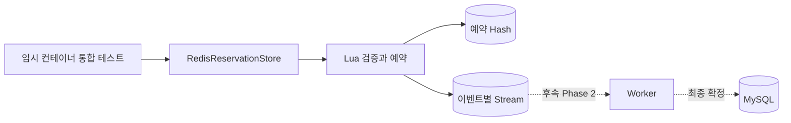

# Redis 쿠폰 예약 구현 검토 보고서

## 결과와 적용 범위

Redis 내부에서 쿠폰 예약과 Stream 작업 기록을 묶는 컴포넌트를 추가했다. 기존 MySQL 발급 API는 계속 DB에서 발급을 확정한다. Redis 예약은 통합 테스트에서 직접 호출하는 내부 기능이며, 사용자 API·최종 확정·Worker 운영까지 완료한 상태는 아니다.

이 단계의 목적은 Redis가 더 빠르다는 결론을 내리는 것이 아니라, 요청 중복·동시 재고 경쟁·명령 실패에 대한 예약 경계를 실제 Redis에서 검증하는 것이다.



## 핵심 변경과 선택 이유

| 변경 | 이유와 검토할 점 |
|---|---|
| 명시적인 발급 전 초기화 | 재시도 때 DB 잔량으로 Redis를 다시 채우는 오류를 피한다. DB 발급 방식과의 배타성은 공개 연결 전에 구현해야 한다. |
| 재고와 사용자 예약을 같은 Hash에 저장 | 한 번의 `HSET`으로 두 값을 변경한다. 사용자 예약은 `user:{userId}` 필드에 메시지 ID로 저장한다. |
| Lua에서 `XADD` 후 `HSET` | 작업 기록 실패가 재고 차감으로 이어지지 않게 한다. 이후 상태 쓰기 실패는 방금 넣은 작업을 보상 삭제한다. |
| 재요청에 동일 메시지 ID 반환 | 응답 유실 후 같은 사용자로 다시 접수해도 추가 차감·추가 작업을 만들지 않는다. |
| 이벤트별 Stream과 같은 hash tag | 이벤트 내 키를 같은 Cluster 슬롯에 배치할 수 있다. 향후 Worker의 이벤트 탐색 비용은 별도 설계가 필요하다. |
| ID를 문자열로 유지 | Lua 숫자의 정밀도 때문에 큰 사용자 ID가 서로 같은 값으로 변하는 것을 피한다. |
| 잔량·예약 수·Stream 길이 검사 | 키 일부 유실이나 잘못된 삭제를 발견하면 추가 접수를 중단한다. 전체 무결성 검사나 자동 복구를 대신하지 않는다. |

Lua는 다른 요청이 실행 중간에 끼어들지 않도록 하지만 DB 트랜잭션처럼 자동 롤백하지 않는다. 그래서 쓰기 전 검증과 쓰기 순서·보상 처리가 필요하다. [Redis Lua 실행 문서](https://redis.io/docs/latest/develop/programmability/eval-intro/), [Lua API 오류 처리](https://redis.io/docs/latest/develop/programmability/lua-api/).

## 검증 환경과 재현

- 실행일: 2026-11-24, Mac Darwin arm64, OpenJDK 25.0.4, Docker Engine 29.8.2.
- Gradle Wrapper 9.8.2, Spring Boot 4.0.9, Spring Data Redis 4.0.8.
- 임시 Testcontainers: Redis `8.2.11-alpine`, 기존 DB 회귀 테스트의 MySQL `8.4.13`.
- Redis 테스트는 테스트별 독립 이벤트 ID를 사용한다. 기존 Compose·VM 데이터와 실습 키를 읽거나 수정하지 않는다.
- 동시성 시나리오별 요청 40건, 실행 스레드 16개, 시작 래치로 동시 진입을 유도한다. 처리 순서를 고정하는 테스트는 아니다.
- 동시성 시나리오는 최종 실행에서 각 1회 검증했다. 반복 부하·워밍업·TPS·p99 측정은 수행하지 않는다.

```bash
./gradlew build :apps:event-api:integrationTest --no-daemon
```

최종 실행은 `BUILD SUCCESSFUL`이며 결과는 다음과 같다. 실패·오류·스킵은 모두 0건이다.

| 검증 | 테스트 수 | 결과 |
|---|---:|---|
| 기존 도메인 단위 테스트 | 4 | 통과 |
| 기존 MySQL·HTTP·동시성 통합 테스트 | 12 | 통과 |
| 신규 Redis 예약 통합 테스트 | 14 | 통과 |

`docker compose config --quiet`, `git diff --check`, 변경 문서의 로컬 링크 검사도 통과했다. VM 배포나 실제 애플리케이션 데이터 변경은 수행하지 않았다.

Redis 예약 검증만 실행하려면 다음 명령을 사용한다.

```bash
./gradlew :apps:event-api:integrationTest \
  --tests 'com.redis.eventplatform.RedisReservationIntegrationTest' --rerun-tasks
```

## 시나리오별 검증 기준

| 시나리오 | 확인 항목 |
|---|---|
| 정상 예약과 큰 ID | 재고 1 차감, 작업 1건, `Long.MAX_VALUE` 이벤트·사용자 ID 보존, 메시지 스키마 |
| 중복과 응답 유실 재시도 | 같은 메시지 ID 반환, 종료·품절 후에도 추가 차감·작업 없음 |
| 초기화 재호출 | 재고 충전 없음, 설정 변경 거부, DB 잔량이 이미 줄어든 스냅샷 거부 |
| 기간 경계 | 시작 직전 거부, 시작 포함, 종료 직전 허용, 종료 제외를 마이크로초 단위로 검증 |
| 잘못된 ID·미초기화 | 오류 반환, 자동 키 생성 없음 |
| 서로 다른 사용자 동시 40건 | 재고 10개에서 예약 10건·품절 30건, 잔량 0·Stream 10건 |
| 같은 사용자 동시 40건 | 신규 예약 1건·재요청 39건, 잔량 9·Stream 1건 |
| Stream 타입 오류 | 재고·사용자 기록 변경 없음 |
| 음수 재고 손상 | 추가 예약·작업 기록 거부 |
| Hash 쓰기 권한 없음 | Lua의 ACL 사전 검사에서 거부, Stream 기록·재고 차감 없음 |
| Stream 유실 | 길이 불일치 감지, 추가 재고 차감 없음 |
| 상태 Hash 유실 | 자동 재초기화 거부, 남은 Stream 유지 |
| 실제 XADD 명령 실패 | 최대 Stream ID를 설정해 자동 채번 실패 유발, 재고·사용자 기록 유지 |
| XADD 이후 상태 쓰기 실패 주입 | 테스트용 Lua에서 HSET 대상을 잘못된 타입으로 바꿔 오류 주입, 추가 메시지 보상 삭제, 이후 정상 재예약 가능 |

마지막 시나리오는 프로덕션 경로에서 자연 발생한 장애가 아니라 보상 분기를 검증하는 오류 주입이다. 서버 강제 종료·OOM을 재현했다고 해석하지 않는다.

## 남은 범위와 다음 구현

이벤트의 DB 직접 발급과 Redis 예약이 섞이지 않도록 DB에 발급 방식과 활성화 절차를 추가해야 공개 API를 연결할 수 있다. API는 예약을 최종 발급 성공으로 반환하지 않고 접수와 확정을 구분해야 한다.

이후 별도 Worker에서 DB 멱등 확정, 커밋 후 ACK, Pending 회수, 재시도·장기 실패 처리를 구현한다. Worker 재처리에서 Redis 예약 재고를 다시 차감하지 않는다. 사용자별 최종 결과는 MySQL 발급 기록으로 판단한다.

현재 DB 서비스는 처리 시점의 기간을 검사하므로 Worker에서 그대로 호출하면 종료 직전 접수한 유효 예약이 지연 처리 중 거절될 수 있다. 예약 시각과 메시지를 검증하는 별도 확정 경로가 필요하다.

이번 구현은 Hash와 Stream을 보존한다는 전제다. TTL·트리밍·키 삭제·Eviction을 운영 중 허용하려면 보관·대조·복구 정책을 먼저 정의해야 한다. 두 키가 모두 유실된 뒤 오래된 이벤트 스냅샷으로 초기화하는 것도 안전하지 않다. 영속성·복제·서버 중단·네트워크 응답 유실 실험과 실제 Cluster 검증은 남아 있다.

## 코드 검토 순서

1. [예약 Lua](../../modules/event/src/main/resources/redis/reservation/reserve.lua): 검사 순서, XADD 실패 경계, HSET·보상 삭제.
2. [Java 컴포넌트](../../modules/event/src/main/java/com/redis/eventplatform/event/reservation/RedisReservationStore.java): 초기화·재요청 계약, 시간과 ID 처리.
3. [통합 테스트](../../apps/event-api/src/test/java/com/redis/eventplatform/RedisReservationIntegrationTest.java): 동시성 결과와 오류 주입 범위.
4. [ADR 0005](../adr/0005-redis-coupon-reservation.md): 공개 API 연결 전제와 최종 확정의 경계.
